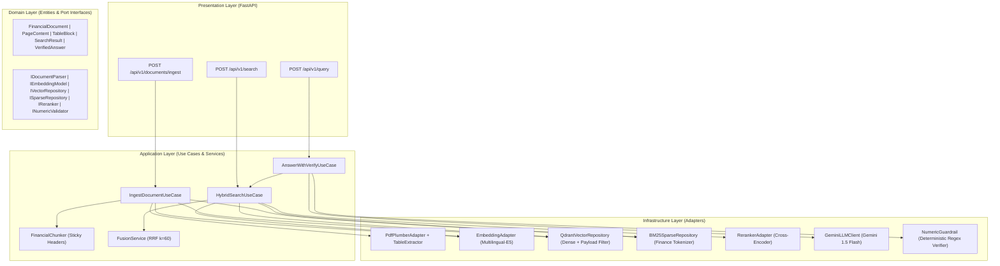

# FinDoc-Engine: High-Precision Financial RAG & Table-Aware Verification System

[](https://www.python.org/)
[](https://blog.cleancoder.com/uncle-bob/2012/08/13/the-clean-architecture.html)
[](https://fastapi.tiangolo.com/)
[](https://qdrant.tech/)
[](https://mypy-lang.org/)
[](https://docs.astral.sh/ruff/)
[](https://docs.pytest.org/)

**FinDoc-Engine** is a production-grade Retrieval-Augmented Generation (RAG) engine purpose-built for parsing, indexing, retrieving, and verifying Vietnamese and international Financial Statements (Bao cao Tai chinh - BCTC). Designed under strict **4-Layer Clean Architecture** principles, it eliminates two critical failure modes of standard RAG systems in finance: **Table Matrix Distortion** and **Numerical Hallucination**.

---

## 1. Core Engineering Problems Solved

1. **Table Matrix Distortion in PDF Parsing**:
   - Standard text splitters break financial tables across arbitrary character boundaries, severing line items (e.g., *Doanh thu thuan*, *Loi nhuan sau thue*) from their corresponding multi-period headers and currency units (*Ty VND*).
   - **Solution**: `TableExtractor` and `PdfPlumberAdapter` detect 2D table bounding boxes, normalize Vietnamese accounting numbers (`(1.250,5)` -> `-1250.5`), and serialize structured `TableBlock` objects into GitHub-Flavored Markdown. `FinancialChunker` injects sticky table headers and metadata prefixes (`[Cong ty: FPT | Bao cao: Q4/2025 | Don vi: Ty VND]`) into every sub-table chunk when splitting oversized tables.

2. **Lexical vs. Semantic Mismatch in Financial Queries**:
   - Dense embeddings capture semantic intent but struggle with exact financial tickers (`FPT`, `VNM`, `HPG`), accounting codes (`Ma so 10`, `Ma so 60`), and ratios (`ROE`, `EBITDA`, `EPS`).
   - **Solution**: A dual-path **Hybrid Retrieval Pipeline** combining Dense Vector Search (`Qdrant` + `intfloat/multilingual-e5-base` with $L_2$ normalization) and a finance-aware Sparse Index (`BM25Okapi` preserving financial acronyms and formatted numbers), merged via **Reciprocal Rank Fusion (RRF)** and refined by a **Cross-Encoder Reranker** (`BAAI/bge-reranker-base`).

3. **Zero-Tolerance for LLM Numerical Hallucination**:
   - In financial analysis, a single fabricated figure invalidates the entire report.
   - **Solution**: `NumericGuardrail` acts as a deterministic, zero-AI post-generation verifier. It extracts every integer, decimal, percentage, and parenthesized negative number from the LLM response and cross-verifies them against the union of numbers present in the retrieved source `TableBlock` entities (with configurable relative tolerance $\epsilon = 10^{-2}$ for rounding). Any unverified number immediately triggers `ValidationStatus.FAILED` (or HTTP `422 Unprocessable Entity` in strict mode).

---

## 2. System Architecture & Data Flow

The codebase strictly enforces the **Dependency Rule**: inner layers (`domain`, `application`) have zero knowledge of outer layers (`infrastructure`, `presentation`).



---

## 3. Quantitative Benchmark Results

Evaluated on the ground-truth financial test suite (`data/test_suite/ground_truth.json` / `tests/evaluation/ground_truth.json`) comprising **30 multi-company financial queries** across **FPT**, **VNM**, and **HPG** Q4/2025 Consolidated Financial Statements (Balance Sheet & Income Statement):

| Metric | Value | Target Threshold | Status |
| :--- | :---: | :---: | :---: |
| **Total Benchmark Queries** | `30` | `>= 30` | PASS |
| **Hit Rate @ 1 (Hit@1)** | **100.00%** | `>= 80.00%` | PASS |
| **Hit Rate @ 3 (Hit@3)** | **100.00%** | `>= 90.00%` | PASS |
| **Hit Rate @ 5 (Hit@5)** | **100.00%** | `>= 95.00%` | PASS |
| **Mean Reciprocal Rank (MRR)** | **1.0000** | `>= 0.8500` | PASS |
| **NDCG @ 5** | **1.0000** | `>= 0.8500` | PASS |
| **Retrieval Latency (p50)** | **3.53 ms** | `< 200.00 ms` | PASS |
| **Retrieval Latency (p95)** | **4.53 ms** | `< 500.00 ms` | PASS |
| **Hallucination Detection Rate** | **100.00%** | `100.00%` | PASS |

To reproduce the benchmark results locally:

```bash
python scripts/run_benchmark.py
```

---

## 4. Project Directory Structure

```text
Findoc-engine/
├── data/
│   ├── bm25_index/                 # Persistent BM25 sparse index storage
│   ├── qdrant_storage/             # Local embedded Qdrant vector storage
│   ├── raw_pdfs/                   # Sample BCTC PDFs (FPT, VNM, HPG Q4/2025)
│   └── test_suite/
│       └── ground_truth.json       # 30 benchmark Q&A pairs with expected metrics
├── scripts/
│   ├── download_sample_bctc.py     # Generates realistic wireframe BCTC PDFs
│   └── run_benchmark.py            # CLI runner for the retrieval & guardrail benchmark
├── src/
│   ├── domain/                     # Layer 1: Pure Python Entities & ABC Interfaces
│   │   ├── entities/               # document.py, page.py, table.py, query.py, response.py
│   │   ├── exceptions.py           # FinDocError, ParsingError, HallucinationError, etc.
│   │   └── interfaces/             # i_parser, i_embedder, i_vector_repo, i_sparse_repo, i_reranker, i_validator
│   ├── application/                # Layer 2: Business Use Cases & Domain Services
│   │   ├── dto/                    # ingest_dto.py, search_dto.py
│   │   ├── services/               # financial_chunker.py, fusion_service.py (RRF)
│   │   └── use_cases/              # ingest_document.py, hybrid_search.py, answer_with_verify.py
│   ├── infrastructure/             # Layer 3: External Adapters & Implementations
│   │   ├── config.py               # Pydantic BaseSettings (.env configuration)
│   │   ├── llm/                    # gemini_client.py
│   │   ├── ml_models/              # embedding_adapter.py, reranker_adapter.py
│   │   ├── parsers/                # table_extractor.py, pdfplumber_adapter.py
│   │   ├── persistence/            # qdrant_repo.py, bm25_repo.py
│   │   └── validators/             # numeric_guardrail.py
│   └── presentation/               # Layer 4: FastAPI REST Delivery Layer
│       ├── main.py                 # FastAPI app factory, CORS, Lifespan management
│       └── api/
│           ├── dependencies.py     # Singleton ServiceContainer & FastAPI Depends
│           ├── error_handlers.py   # Domain exception -> HTTP status code mapping
│           └── v1/                 # ingest_routes.py, search_routes.py
├── tests/
│   ├── unit/                       # Isolated unit tests for all layers
│   ├── integration/                # End-to-end pipeline & FastAPI TestClient suites
│   └── evaluation/                 # Quantitative retrieval & guardrail evaluation harness
├── Dockerfile
├── docker-compose.yml
├── pyproject.toml
└── PROGRESS.md
```

---

## 5. Quickstart & Installation

### Prerequisites

- **Python 3.11+**
- **uv** (recommended fast Python package manager) or `pip`

### 5.1. Clone & Install Dependencies

```bash
git clone https://github.com/leanhvu8207-design/FinDoc-engine.git
cd Findoc-engine

# Create virtual environment and install all dependencies (including ML & dev extras)
uv venv
uv pip install -e ".[dev,ml]"
```

### 5.2. Configure Environment Variables

Copy `.env.example` to `.env` (or configure directly):

```env
APP_NAME=FinDoc-Engine
APP_ENV=development
DEBUG=false

# Qdrant Vector DB Configuration (Local Embedded Mode requires no Docker daemon)
QDRANT_USE_LOCAL=true
QDRANT_LOCAL_PATH=./data/qdrant_storage
QDRANT_HOST=localhost
QDRANT_PORT=6333
QDRANT_COLLECTION_NAME=financial_documents

# Embedding & Reranker Models
EMBEDDING_MODEL_NAME=intfloat/multilingual-e5-base
VECTOR_DIM=768
RERANKER_MODEL_NAME=BAAI/bge-reranker-base

# LLM Configuration (Google Gemini)
GEMINI_API_KEY=your_gemini_api_key_here
GEMINI_MODEL_NAME=gemini-1.5-flash
```

### 5.3. Generate Sample Financial PDFs & Run Server

```bash
# Generate 3 sample Consolidated Financial Statements (FPT, VNM, HPG Q4/2025)
python scripts/download_sample_bctc.py

# Launch FastAPI server
uvicorn src.presentation.main:app --host 0.0.0.0 --port 8000 --reload
```

Interactive OpenAPI documentation is available at:
- **Swagger UI**: `http://localhost:8000/docs`
- **ReDoc**: `http://localhost:8000/redoc`

---

## 6. API Endpoints Reference

### 6.1. Health Check (`GET /health`)

```bash
curl -X GET http://localhost:8000/health
```

### 6.2. Ingest Financial PDF (`POST /api/v1/documents/ingest`)

Supports both multipart file upload (`file`) and server-side path (`file_path`).

```bash
curl -X POST "http://localhost:8000/api/v1/documents/ingest" \
  -F "file=@data/raw_pdfs/FPT_2025_Q4_Consolidated.pdf" \
  -F "company_name=Cong ty Co phan FPT" \
  -F "ticker=FPT" \
  -F "report_type=BCTC Hop nhat Quy 4" \
  -F "fiscal_year=2025" \
  -F "fiscal_quarter=4" \
  -F "currency=VND" \
  -F "unit_multiplier=1000000000" \
  -F "is_audited=false"
```

**Response (`201 Created`)**:
```json
{
  "doc_id": "fpt-2025-q4-consolidated",
  "ticker": "FPT",
  "fiscal_year": 2025,
  "total_pages": 2,
  "total_tables_extracted": 2,
  "total_chunks_indexed": 4,
  "dense_vectors_upserted": 4,
  "sparse_chunks_indexed": 4,
  "status": "SUCCESS"
}
```

### 6.3. Hybrid Search (`POST /api/v1/search`)

Executes Dense + Sparse BM25 retrieval, RRF fusion, and Cross-Encoder reranking with strict metadata filtering.

```bash
curl -X POST "http://localhost:8000/api/v1/search" \
  -H "Content-Type: application/json" \
  -d '{
    "query_text": "Doanh thu thuan ve ban hang va cung cap dich vu Q4/2025",
    "ticker": "FPT",
    "fiscal_year": 2025,
    "fiscal_quarter": 4,
    "top_k": 3
  }'
```

### 6.4. Answer with Numeric Verification (`POST /api/v1/query`)

Synthesizes an executive financial answer grounded in the retrieved `TableBlock` context and runs `NumericGuardrail` to verify every number before returning.

```bash
curl -X POST "http://localhost:8000/api/v1/query" \
  -H "Content-Type: application/json" \
  -d '{
    "query_text": "Tong tai san va Loi nhuan sau thue cua FPT nam 2025 la bao nhieu?",
    "ticker": "FPT",
    "fiscal_year": 2025,
    "top_k": 3,
    "raise_on_hallucination": true
  }'
```

**Response (`200 OK`)**:
```json
{
  "query": "Tong tai san va Loi nhuan sau thue cua FPT nam 2025 la bao nhieu?",
  "answer": "Theo BCTC Hop nhat Quy 4/2025 cua FPT, Tong cong tai san dat 65.400,0 ty VND va Loi nhuan sau thue thu nhap doanh nghiep dat 2.496,4 ty VND.",
  "validation_report": {
    "status": "PASSED",
    "extracted_numbers": [4.0, 2025.0, 65400.0, 2496.4],
    "verified_numbers": [4.0, 2025.0, 65400.0, 2496.4],
    "hallucinated_numbers": [],
    "Verification_rate": 1.0,
    "details": "All extracted financial numbers matched the source context."
  },
  "is_trustworthy": true,
  "model_name": "gemini-1.5-flash"
}
```

---

## 7. Quality Assurance & Engineering Standards

All code changes are validated against three automated gates:

```bash
# 1. Code Formatting & Linting (Ruff)
ruff check src tests scripts

# 2. Static Type Checking (Mypy Strict Mode)
mypy src tests scripts

# 3. Unit, Integration & Benchmark Test Suites (Pytest)
pytest
```
